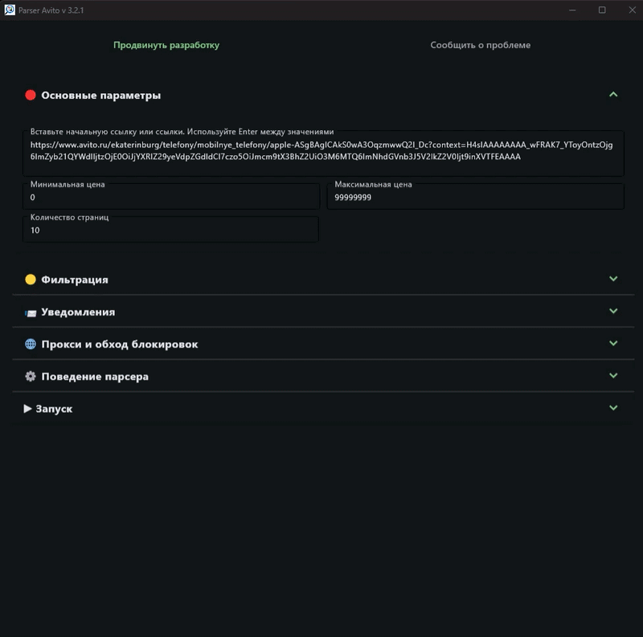

## Avito Parser

**Avito Parser** — это инструмент для автоматического мониторинга новых объявлений на Avito, с возможностью мгновенной отправки уведомлений в (TG, VK) и экспорта в Excel. Идеально подходит для продавцов, аналитиков и всех, кто следит за ценами и предложениями.


📜 **История изменений** — [смотреть](docs/CHANGELOG.md)

📚 **Документация для разработчиков** — [смотреть](docs/DOCS.md)



### Последние изменения

### [3.3.2] - 2026-11-23
#### Изменено
- При старте парсер проверяет, что трафик действительно уходит через USB-модем
- Автоматически подбирается рабочий режим привязки: `IP_UNICAST_IF` + `bind`, `bind` + `IP_UNICAST_IF` или только `IP_UNICAST_IF`
- Если ни один режим не даёт соединения через модем, парсинг не запускается и не уходит молча через Ethernet/Wi-Fi
- Улучшена диагностика: в ошибке перечисляются проверенные режимы и причины отказа

### [3.3.1] - 2026-11-22
#### Изменено
- Стратегия смены IP заменена на `fast_then_reboot`: быстрое переподключение PDN, при неизменившемся WAN IP — перезагрузка модема
- Переход на 3G/`Only_WCDMA` полностью исключён: модем остаётся в LTE
- Добавлены таймаут восстановления после перезагрузки и лимит перезагрузок
- Добавлена защита от одновременных ротаций и корректная обработка остановки парсера
- Улучшены логи этапов DISCONNECT/CONNECT/REBOOT и проверки регистрации в LTE

### [3.3.0] - 2026-11-20
#### Добавлено
- Поддержка USB 4G модема **ZTE MF823D** (и совместимых ZTE): парсер работает через модем, даже если есть Wi-Fi/Ethernet
- Автоматическая смена IP при блокировке Avito: быстрое переподключение PDN (2–5 секунд), при необходимости — перезагрузка модема с сохранением LTE
- Кнопка «Проверить модем» в GUI и консольная утилита `scripts/modem_cli.py`
- Скрипты автозапуска с Windows (Планировщик задач / автозагрузка) и headless-режим без окна
- Документация: [USB 4G модем](docs/USB_MODEM.md) и [автозапуск Windows](docs/WINDOWS_AUTOSTART.md)

### [3.2.23] - 2026-09-30
#### Добавлено
- Добавлена настройка «Парсить описание полностью». Она загружает полное описание объявления вместо короткого текста из списка
- Добавлена автоматическая очистка старых логов. Логи старше 5 дней удаляются, а их общее количество ограничено

#### Исправлено
- Парсинг просмотров и полного описания теперь использует данные карточки объявления. Если включены обе настройки, данные загружаются одним запросом
- Результаты сохраняются после каждой страницы. Уже собранные объявления не потеряются, если на следующей странице возникнет ошибка
- Окно программы больше не зависает во время парсинга и корректно реагирует на кнопку «Стоп»
- Исправлены ошибки фильтра по адресу и другим параметрам, если в объявлении не хватает части данных
- Исправлено сохранение в Excel объявлений без цены, даты, координат, фотографий и других необязательных данных
- Исправлена проверка и установка браузера Playwright в Windows, Linux и macOS
- Старые параметры в `config.toml` больше не мешают запуску программы
- При блокировке или сетевой ошибке программа корректно меняет прокси, обновляет cookies и повторяет запрос
- Увеличено время ожидания ответа сервиса cookies, чтобы медленные ответы реже приводили к ошибке

### Возможности

#### 📌 Основные
- Мониторинг новых объявлений на Avito в реальном времени
- Выгрузка найденных объявлений в Excel
- Кроссплатформенность (Windows, Linux, macOS)

#### ⚙️ Гибкие настройки
- Чёрный/белый список ключевых слов
- Фильтр по региону и продавцам
- Ограничение по времени публикации
- Парсинг количества просмотров
- Поддержка прокси (автоматический обход бана IP)
- Поддержка обхода блокировок через сторонний сервис
- Работа через USB 4G модем ZTE MF823D с автоматической сменой IP

#### 📬 Уведомления и хранение
- Отправка уведомлений в Telegram (несколько получателей)
- Отправка уведомлений в VK (несколько получателей)
- Игнорирование уже просмотренных объявлений
- Отслеживание изменения цены
- Сохранение в Excel

#### 🚀 Производительность
- Высокая скорость работы
- Постоянная проверка в фоновом режиме
- Поддержка до 100 ссылок для отслеживания (в режиме без графического интерфейса ограничений нет)

#### 🐳 Режимы запуска
- С графическим интерфейсом (GUI)
- В консольном режиме (CLI)
- В Docker-контейнере

---

### 🎥 Обзор и видео
- [Обзор последней версии](https://youtu.be/hh4kYBfjRcA)
- [Как запустить локально и на сервере, подробная инструкция для новичков](https://youtu.be/_XQW2ApNwiQ) — хоть и про старую версию, но настоятельно рекомендую посмотреть  
- [Плейлист разработки](https://www.youtube.com/playlist?list=PLK9kK8z0fpqxPakGZvxo7y6HtCBTYihUF)

---

## 🚀 Быстрый старт (Windows)

1. Скачать архив из [релизов](https://github.com/Duff89/parser_avito/releases)
2. Запустить AvitoParser.exe
3. Заполнить настройки
4. Нажать Старт


Если по каким-то причинам предыдущий вариант не запускается - всегда можно запустить как обычный Python проект.
Для этого требуется Python 3.11+. Скопируйте проект и установите зависимости:

```bash
  pip install -r requirements.txt
```

Если файла `config.toml` нет (например, при клонировании репозитория),
скопируйте шаблон:

```bash
  copy config.example.toml config.toml
```

Запустите **AvitoParser.py** (режим с графическим интерфейсом)

```bash
  python AvitoParser.py
```

Если Вам необходимо запустить парсер на сервере (режим без графического интерфейса), запускайте:

```bash
  python parser_cls.py
```

### 📶 USB 4G модем и автозапуск

Если парсер работает через USB-модем ZTE MF823D, включите в GUI галочку
**«Работать через USB 4G модем»** (раздел «Прокси и обход блокировок») или
пропишите в `config.toml`:

```toml
use_usb_modem = true
modem_rotation_strategy = "fast_then_reboot"
block_threshold = 1
retry_delay = 1
modem_reboot_on_fail = true
modem_reboot_timeout = 120
modem_max_reboots = 1
```

При блокировке Avito парсер сам сменит IP модема: сначала быстрым
переподключением (2–5 секунд), а если оператор вернул тот же адрес —
перезагрузкой модема. Модем остаётся в LTE, переход на 3G не используется.
При старте парсер проверяет фактический выход через модем и при неудаче
не запускается.

Для запуска вместе с Windows:

```bat
scripts\windows\install_autostart.bat
```

Подробно: [USB 4G модем](docs/USB_MODEM.md) и
[автозапуск Windows](docs/WINDOWS_AUTOSTART.md).

📘 Остальная документация:
- [USB 4G модем ZTE MF823D: работа через модем и смена IP](docs/USB_MODEM.md)
- [Автозапуск вместе с Windows](docs/WINDOWS_AUTOSTART.md)
- [Обход блокировок](docs/ANTIBLOCK.md)
- [Уведомления (Telegram, VK)](docs/NOTIFICATIONS.md)
- [Docker и сервер](docs/DOCKER.md)
- [Для разработчиков](docs/DOCS.md)

---

## 🛠 Обратная связь

Если нашли баг или хотите предложить улучшение — создайте issue [на GitHub](https://github.com/Duff89/parser_avito/issues).

При описании ошибки укажите:
- Вашу ОС
- Версию скрипта
- Способ запуска
- Скриншот/логи ошибки

---

### ❤️ Поддержка проекта

Если хотите, чтобы проект развивался быстрее:
- [Поддержать через YooMoney](https://yoomoney.ru/to/410014382689862)
- Переводом на карту: 2204 1201 0103 5539

---

###  📧️ Прямая связь с автором
Пожалуйста, не нужно писать на почту насчет ошибок\багов в парсере, для этого есть [issue](https://github.com/Duff89/parser_avito/issues)

 📧 Email: sergeichopolovich1989@gmail.com

> Программное обеспечение предоставляется «как есть» (as is), без явных или подразумеваемых гарантий.
Автор не гарантирует стабильную работу, соответствие ожиданиям пользователя или отсутствие ошибок.
Использование осуществляется на собственный риск пользователя. 
> Автор не несёт ответственности за любые последствия